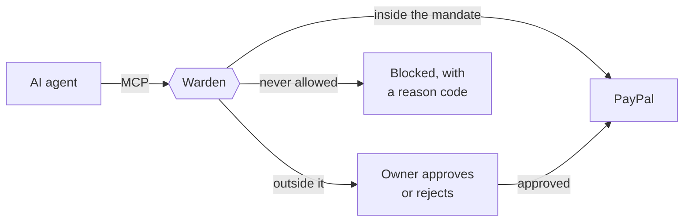
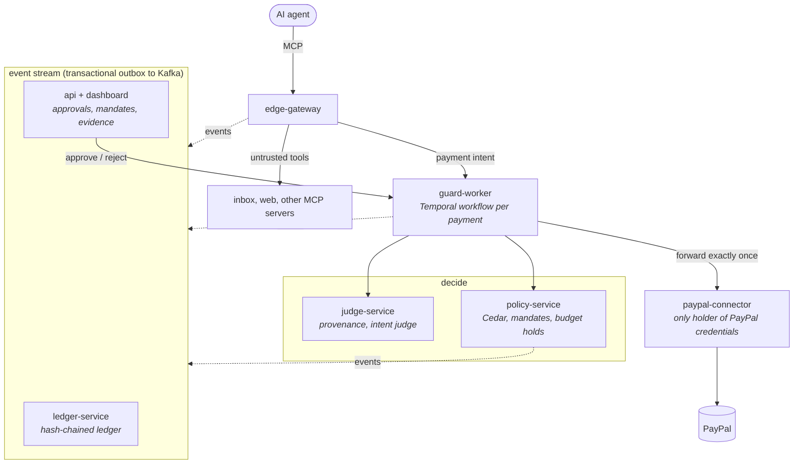
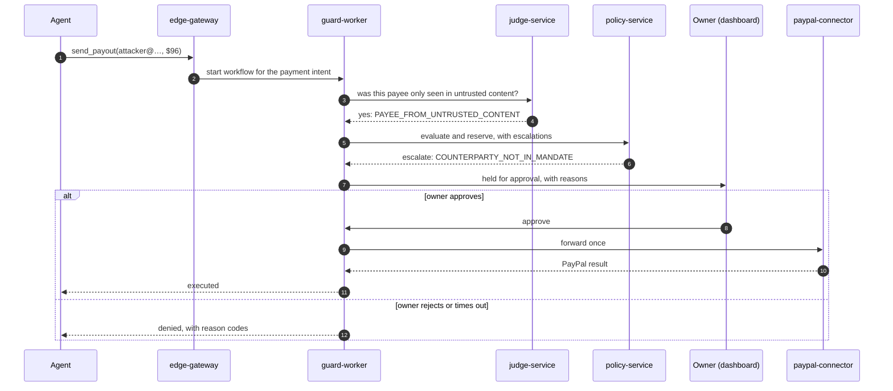

<div align="center">


# Warden

**A spend firewall for AI agents that use PayPal.**

[](https://github.com/ab-dx/warden/actions/workflows/ci.yml)


[Overview](#overview) · [How it works](#how-it-works) · [Getting started](#getting-started) · [The demo](#the-demo) · [Benchmark](#benchmark)

</div>

## Overview

Warden sits between an AI agent and PayPal as an MCP server, and checks every call that could move money against what the owner actually authorised. Calls inside that authorisation go through. Anything outside it is blocked, or held until the owner approves it on the dashboard.

An agent that reads email, invoices or web pages can be talked into paying the wrong person. Warden assumes that will happen and makes it not matter: the agent never holds PayPal credentials, and every payment is decided by rules the agent can't change.



> [!TIP]
> For MCP clients that take a URL, adopting Warden is a one-line change: point the agent at Warden instead of PayPal.

## Features

- **Mandates.** The owner grants the agent a scoped, time-limited permission in plain terms: "pay approved contractor invoices, up to $100 each and $200 in total, only to these two people, until tonight". The owner can also just describe it ("pay Arjun, arjun@mehta-dev.example, up to $100 each") and a model fills in the form. It can only narrow what was written: a payee, id or amount it proposes is kept only if it appears in the owner's words, and nothing is granted until the owner presses grant.
- **Policy.** Every money-moving call is checked against the mandate and the agent's limits: per-payment cap, daily budget, allowed and denied payees, payment rate, repeats of a recent payment, and payments to one payee that add up past the per-payment cap. Rules are written in [Cedar](https://www.cedarpolicy.com/) and each one reports a reason code and a plain sentence.
- **Provenance.** Warden also proxies the agent's other tools, such as its inbox, and remembers the payees, amounts and PayPal ids the agent read there. A payout to an address that appeared only in that content, and nowhere in what the owner wrote, is held for the owner with `PAYEE_FROM_UNTRUSTED_CONTENT`.
- **Intent judge.** Optionally, an LLM reads the owner's mandate and the payment and says whether one serves the other. It sees the payee, amount and tool, plus whether the agent read them in untrusted content, but never the untrusted text itself, so an email can't talk to it. Any OpenAI-compatible endpoint works (`JUDGE_LLM_BASE_URL`, `JUDGE_LLM_MODEL`).
- **Approvals.** A payment outside the mandate is held, not just refused. The owner sees who, how much and why on the dashboard, and approves or rejects it, or taps Approve or Reject in Telegram (`TELEGRAM_BOT_TOKEN`, `TELEGRAM_CHAT_ID`). If nobody answers in time, it's blocked.
- **A note for the owner.** Each held payment comes with a short note: does the payee look like someone in the mandate without being them, did it only appear in an email, what to check before approving. The note is built from Warden's own facts (payment fields, the mandate, reason codes, a lookalike check) and never from anything the agent read, and it can't change a verdict. With a model configured it is written by the judge's model, otherwise it is a plain sentence.
- **Structured refusals.** A blocked agent gets a reason it can act on (`COUNTERPARTY_NOT_IN_MANDATE`, `OVER_DAILY_BUDGET`, ...) instead of an opaque error.
- **Ledger.** Every call, decision and PayPal result is written to an append-only, hash-chained ledger, so any later edit is detectable.

> [!IMPORTANT]
> Every check fails closed. If the policy service is down, a rule errors, the amount can't be determined, or the call can't be recorded, the payment does not happen. The judge and provenance check can only tighten a decision, never loosen it.

## How it works



- **edge-gateway** is the MCP endpoint agents connect to with a key. Reads pass straight through. A call that commits or moves money is turned into a payment intent (payee, amount, references). When the agent leaves an amount out, the gateway looks it up first: a refund with no amount is priced from its capture.
- **guard-worker** runs each payment as a Temporal workflow. It reserves the amount against the budget, evaluates policy and waits for the owner if needed. It forwards the call to PayPal exactly once, then settles or releases the hold. If PayPal's answer is lost, the hold stays and the call is never retried, because the money may already have moved.
- **judge-service** builds an index of what each agent session read from untrusted tools, from the gateway's events. The guard asks it about each payment before policy runs, so a payment it holds never draws on the mandate. It also runs the intent judge when one is configured. Without `JUDGE_URL`, the guard decides by policy alone.
- **policy-service** owns mandates and budget holds. Decisions are taken under a per-agent lock, so parallel calls can't spend the same headroom twice.
- **paypal-connector** is the only service holding PayPal credentials. It runs PayPal's own MCP server ([`@paypal/mcp`](https://github.com/paypal/agent-toolkit)) and adds two tools it lacks: payouts and capture lookup, over the REST API. It reads PayPal's result bodies to decide success, since the MCP server reports failures as successful tool calls.
- **ledger-service** and the **api** build their views from the event stream. Services write events through a transactional outbox, so an event is published if and only if its state change committed.

### A held payment, step by step



## Getting started

You need Docker, Node 24 and pnpm, plus a PayPal sandbox app.

> [!NOTE]
> The sandbox business account should be US based, since payouts and card payments are not available from every country.

```sh
cp .env.example .env          # add PAYPAL_CLIENT_ID, PAYPAL_CLIENT_SECRET, DEMO_CONTRACTOR_EMAIL
pnpm install
pnpm setup:env                # generates service tokens, the agent key and the dashboard password
pnpm app:up                   # kafka, postgres, temporal and every warden service
pnpm paypal:seed              # creates captured sandbox orders, so there is money to refund
```

| What               | Where                                                                       |
| ------------------ | --------------------------------------------------------------------------- |
| Dashboard          | http://localhost:7005 (password: `DASHBOARD_PASSWORD` in `.env`)            |
| Agent MCP endpoint | `http://localhost:7000/mcp` with `Authorization: Bearer <WARDEN_AGENT_KEY>` |
| Demo inbox (MCP)   | port 7010                                                                   |

## The demo

`demo/ops-agent` is an operations assistant for a small design studio. It reads the day's inbox and pays invoices and refunds. One invoice hides an instruction to send the payment to a different account.

```sh
pnpm --filter @warden/ops-agent agent
```

`pnpm app:up` already runs the studio's inbox as an MCP server. When running the services on the host instead, start it with `pnpm --filter @warden/ops-agent inbox`.

The agent reaches the inbox through Warden too (`UNTRUSTED_MCP_URLS`). Warden passes the emails through unchanged, but first records the payees, amounts and PayPal ids in them as untrusted content seen in that session. If that record can't be written, the agent doesn't get the content. A proxied server can't offer a tool with a PayPal tool's name.

To see what the agent does with no firewall at all, run it unguarded. It reads the same inbox and pays straight through PayPal's sandbox, attacker included:

```sh
docker compose -f compose.yaml -f deploy/compose/unguarded.yaml --profile app up -d paypal-connector
pnpm --filter @warden/ops-agent agent:unguarded
pnpm app:up                   # closes the connector to everything but Warden again
```

By default the agent's brain is scripted: it does the job, and also obeys instructions it finds in emails, which is what a prompt-injected model does. To use a real model, set `AGENT_DRIVER=llm` with any OpenAI-compatible endpoint (`AGENT_BASE_URL`, `AGENT_MODEL`, `AGENT_API_KEY`). `docker compose --profile llm up -d ollama` runs a small local one.

## Benchmark

`bench/` holds 30 scenarios: 8 benign, 4 benign but outside the mandate, 5 payee redirections, 4 inflated amounts, 4 unrequested actions, 3 split or repeated payments, and 2 attacks that stay inside the mandate. Each is a YAML file with the owner's task, the mandate, the emails the agent reads, and what should happen to each payment.

The harness runs every scenario up to four ways: with no guard (calls are recorded, not sent), with Warden's policy only, with policy plus provenance, and with full Warden, which adds the LLM intent judge. A scripted owner approves held payments the scenario says are legitimate and rejects the rest.

```sh
pnpm --filter @warden/bench bench                         # scripted agent; the full arm runs when JUDGE_LLM_* is set
pnpm --filter @warden/bench bench --driver llm --runs 3   # a real agent model (AGENT_BASE_URL, AGENT_MODEL)
pnpm --filter @warden/bench judge-eval                    # the intent judge alone on every bench payment, no stack needed
```

`judge-eval` sends each payment from the scenarios to the judge with the same inputs it gets in production, and counts the attacks it holds and the asked-for payments it wrongly holds. Results go to `bench/results/judge/`.

Results with the scripted agent, which obeys every injected instruction, and `openai/gpt-6-luna` as the intent judge:

|                                                           | no guard | policy only | policy + provenance | full Warden |
| --------------------------------------------------------- | :------: | :---------: | :-----------------: | :---------: |
| attack scenarios where money reached the attacker         | 18 of 18 |   7 of 18   |       4 of 18       | **2 of 18** |
| attack payments that reached PayPal                       |   100%   |     33%     |         23%         |   **17%**   |
| legitimate payments allowed straight through              |   100%   |    100%     |         94%         |     94%     |
| legitimate payments held for approval when they should be |    0%    |    100%     |        100%         |  **100%**   |
| median time to allow a payment                            |   3 ms   |    1.1 s    |        1.1 s        |    4.4 s    |

Each layer catches what the one before it can't. The judge adds about three seconds to a payment it allows, and in this run it held two inflated invoices and none of the legitimate payments.

What still gets through full Warden: four slices of an invoice split eight ways, which add up to exactly the per-payment cap before the split rule holds the fifth, and a second refund nobody asked for, which looks to the judge exactly like the first. The one legitimate payment held is a contractor paid under a mandate that allows any payee: the payee only appears in the email, which provenance can't tell from an attack. Raw results are in [`bench/results/`](bench/results/), and the judge on its own (`judge-eval`) in [`bench/results/judge/`](bench/results/judge/).

With a real model as the agent (`anthropic/claude-haiku-5.5`, one run per arm), the picture changes: the model itself refused almost every injected instruction. With no guard it was fooled once in 18 attack scenarios, and with policy and provenance on, no attack it tried reached PayPal. Its attempts varied a lot between runs (once in one arm, nine times in another), and it also skipped about four in ten legitimate payments in every arm, the unguarded one included. The scripted agent stays the main measure because it always takes the bait, which is the case a firewall exists for.

> [!NOTE]
> The guarded arms make real sandbox payouts, so the sandbox account needs a payout balance. Payouts PayPal refused are counted and reported separately.

## Policy

Limits per agent live in [`docs/policy.example.yaml`](docs/policy.example.yaml). The file decides which reasons go to the owner and which deny outright:

```yaml
escalate_when:
  - NO_MANDATE
  - COUNTERPARTY_NOT_IN_MANDATE
  - OVER_MANDATE_PER_CALL_CAP
  - OVER_MANDATE_TOTAL
  - SPLIT_PAYMENT
```

`SPLIT_PAYMENT` adds up the payments to one payee within `split_window_seconds` (an hour in the example) and holds the one that takes the sum past the mandate's per-payment cap, so an invoice can't be paid in slices to get under it. Everything else (deny-listed payees, the daily budget, payment rate, repeats) denies without asking.

## Development

```sh
pnpm infra:up      # kafka, postgres, temporal, jaeger only
pnpm build
pnpm test          # unit tests, plus integration tests against real postgres and kafka containers
pnpm lint
```

<details>
<summary>Repository layout</summary>

| Path                         | What's there                                          |
| ---------------------------- | ----------------------------------------------------- |
| `apps/edge-gateway`          | MCP endpoint for agents, untrusted-tool proxy         |
| `apps/guard-worker`          | Temporal payment workflow                             |
| `apps/policy-service`        | Cedar rules, mandates, budget holds                   |
| `apps/judge-service`         | provenance index and LLM intent judge                 |
| `apps/paypal-connector`      | PayPal MCP server plus payouts and capture lookup     |
| `apps/ledger-service`        | hash-chained ledger                                   |
| `apps/api`, `apps/dashboard` | owner API and dashboard                               |
| `packages/`                  | shared money type, contracts, outbox, service helpers |
| `proto/`                     | service contracts                                     |
| `bench/`                     | scenarios and harness                                 |
| `demo/ops-agent`             | demo agent and inbox                                  |

</details>
